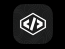

# ⚡ Potassium Hub

<div align="center">



**The Premier High-Performance Luau Experience Suite for the Potassium Executor**

[](https://luau-lang.org/)
[](https://github.com/goggi22/potassium-hub)
[](#-visual-language--architecture)
[](#-integrated-config-manager)
[](#-supported-experiences)
[](#)

</div>

---

## 🚀 Quick Execution

Run the one-line universe-aware master loader directly inside Potassium:

```lua
loadstring(game:HttpGet("https://raw.githubusercontent.com/goggi22/potassium-hub/main/loader.luau"))()
```

> **Smart Universe & Place Auto-Detection**: The loader inspects both `game.GameId` (Universe ID) and `game.PlaceId` on launch with zero client-side caching. If you are inside a supported experience, match instance, or sub-place, it boots that game's tailored suite automatically with a toast notification. If unsupported, it seamlessly mounts the **Universal Engine**.

---

## 🎮 Supported Experiences

| Experience | Universe / Place ID | Status | Key Features |
| :--- | :---: | :---: | :--- |
| **[Jump To Steal Baddies!](games/steal_baddies.luau)** | `10769344844`<br>`121362092826008` |  | Auto-Collect, Auto-Steal Baddies (Rarity Whitelist), Anti-Lasers, Obby Tier Teleports (up to Infinity $Y=7590$), Noclip, 3D Fly, Config Save |
| **[Lucky Islands](games/lucky_islands.luau)** | `6265007289`<br>`18134283205` |  | Auto Lucky Block, Auto Loot Vacuum, Dynamic Anti-Void, Kill Aura, 3D ESP, Standalone & Hub Mountable |
| **[Towers of Fortune](games/towers_of_fortune.luau)** | `3724395896`<br>`108114331578868` |  | 100% Anti-KB, 0.02s InstaBreak, Drop Vacuum, Smart Dynamic Anti-Void ($Y < 45$), Server Packet Aura, SafeWalk |
| **[Fling Arena 💥](games/fling_arena.luau)** | `10772462583`<br>`117273975798730` |  | High-Res Lucide Icons, Fling Assist, Auto-Dodge, Arena Wallhack, Anti-Fling Shield |
| **[Texas Granny](games/texas_granny.luau)** | `6625841029`<br>`99507719593544` / `128897979987102` |  | Granny & Item ESP, Trap Disarmer, Objective Autowalker, Speed & Jump Booster |
| **[Хрущёвка 🎃 (Horror)](games/khrushchyovka.luau)** | `2873491823`<br>`82115753075808` |  | Entity ESP, Fullbright / NightVision, Infinite Stamina, Door Unlocks, Event Tracker |
| **[[⚔️] 1.8 KIT PVP](games/kit_pvp_1_8.luau)** | `2618305829`<br>`72393956865647` |  | Combat Assist, Reach Modifier, Velocity-smooth Safe Movement, Player ESP, Kit Auto-Select |
| **[STRAFEX [Spear Mace!]](games/strafex.luau)** | `4639201948`<br>`129861507977954` |  | **Native Liquid Glass** (No Rayfield CDN dependency), Reach, Fall-Smash Mace Assist, Fast Clicker, Anti-KB, Combat ESP, Config Persistence |
| **[[🌳] +1 Sword Vs Platforms](games/sword_vs_platforms.luau)** | `10768385990`<br>`96222041874857` |  | **Smart Gate Navigator** (100% Green/Gold Door Solver), Chest Harvester, Screen MultiPopup Auto-Clicker, AFK Zone Trainer, Auto Rebirth, Auto Best Weapon/Shield, Direct Teleports |
| **[Universal Engine](games/universal.luau)** | *Any Game* |  | 3D Physics Flight, Noclip, Player ESP, Fullbright, Ctrl+Click TP, Anti-AFK (20 min bypass), Server Hop, Config Manager |

---

## 💎 Visual Language & Architecture

All suites are built with the **Liquid Glass × Material Design 3 (MD3)** framework:

* **Translucent Acrylic Glass**: Ambient blurred containers, specular rim highlights (`UIStroke` gradients), and deep obsidian surfaces (`#0D1018`).
* **Zero External Dependencies**: All UI components are rendered natively via `src/ui/liquid_glass.luau` without unmaintained external CDNs.
* **Integrated Config / Save Manager**: Toggles, sliders, keybinds, and options persist automatically across game hops via `writefile` / `readfile` JSON profiles in `potassium_hub/configs/`.
* **Universal Panic / Unload Hook**: Pressing **`[End]`** silently unloads all active suites, disconnects render loops, deletes ScreenGuis, and resets player state.
* **Cache-Busted HTTP Requests**: Every asset and script fetch includes an epoch/random parameter to bypass raw GitHub client caching.
* **Delta-Safe Movement**: Avoids raw positional snaps that trigger server-side delta checks; uses smooth multi-tick lerping and legitimate client physics velocity (`AssemblyLinearVelocity`).

---

## 📂 Repository Structure

```
potassium-hub/
├── loader.luau               # Smart Universe & PlaceId Auto-Detect Master Loader
├── init.luau                 # Entrypoint alias for HttpGet
├── README.md                 # Complete documentation & game index
├── assets/
│   └── icon.png              # High-definition suite branding
├── examples/
│   └── demo.luau             # Standalone Liquid Glass demo (A E T H E R)
├── games/
│   ├── steal_baddies.luau    # Jump To Steal Baddies! Suite
│   ├── lucky_islands.luau    # Lucky Islands Suite
│   ├── towers_of_fortune.luau# Towers of Fortune Suite
│   ├── texas_granny.luau     # Texas Granny Suite
│   ├── fling_arena.luau      # Fling Arena Suite
│   ├── khrushchyovka.luau    # Khrushchyovka [Horror] Suite
│   ├── kit_pvp_1_8.luau      # 1.8 KIT PVP Suite
│   ├── strafex.luau          # STRAFEX [Spear Mace!] Suite (Pure MD3)
│   ├── sword_vs_platforms.luau# +1 Sword Vs Platforms Suite (Pure MD3)
│   └── universal.luau        # Universal Game Suite (Pure MD3)
└── src/
    └── ui/
        └── liquid_glass.luau # Standalone Liquid Glass × MD3 UI Framework
```

---

## ⌨️ Keybindings

* **`V`** or **`RightControl`** : Toggle GUI visibility
* **`RightShift`** : Alternative toggle (STRAFEX / Towers of Fortune)
* **`End`** : **Universal Panic Button** (Instant detach and cleanup of all threads and UIs)
* **`Space` / `LeftShift`** : Vertical climb / descent in 3D Flight
* **`Ctrl + LeftClick`** : Instant cursor teleport (Universal Suite)
* **Floating Pill** : Click the floating cyan pill at the top of the screen to restore the menu.

---

## 🔧 Standalone UI Framework & Demo

To explore or use the Liquid Glass UI framework independently in your own scripts:

```lua
-- Run the standalone A E T H E R demo:
loadstring(game:HttpGet("https://raw.githubusercontent.com/goggi22/potassium-hub/main/examples/demo.luau"))()
```

Or consume the library directly:

```lua
local LiquidGlass = loadstring(game:HttpGet("https://raw.githubusercontent.com/goggi22/potassium-hub/main/src/ui/liquid_glass.luau"))()

local Hub = LiquidGlass.new({
    Title = "MY SCRIPT",
    Subtitle = "Powered by Liquid Glass",
    ConfigFolder = "MyScript",
    Keybind = Enum.KeyCode.RightControl,
    PanicKey = Enum.KeyCode.End,
})

local Tab = Hub:CreateTab("Combat", "⚔️")
Tab:AddToggle("Auto Attack", false, function(state)
    print("State:", state)
end, "AutoAttackFlag")

-- Save & Load Config
Hub:SaveConfig("default")
Hub:LoadConfig("default")
```

---

<div align="center">

Crafted for **[Potassium](https://github.com/goggi22/potassium-hub)** • Maintained by **goggi22**

</div>
